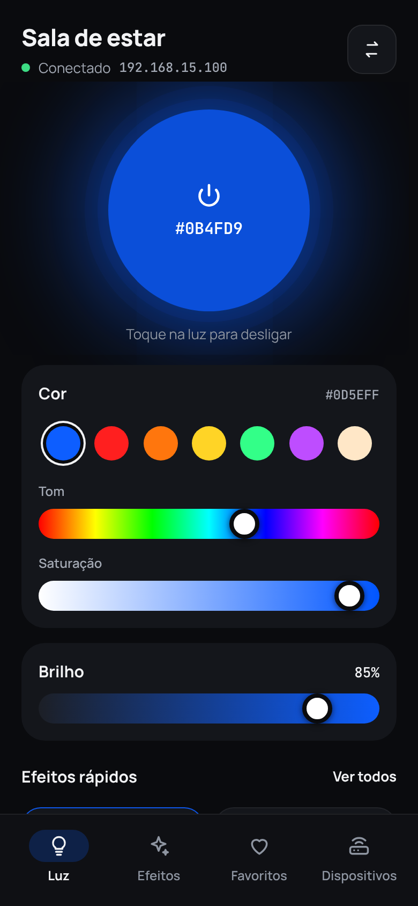
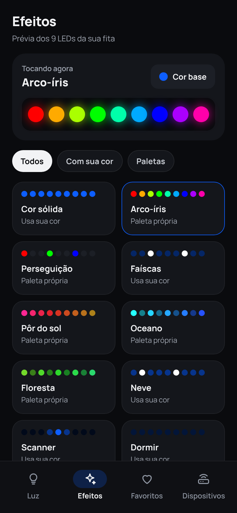
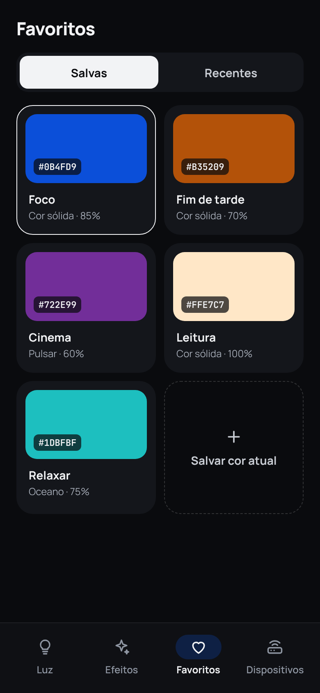
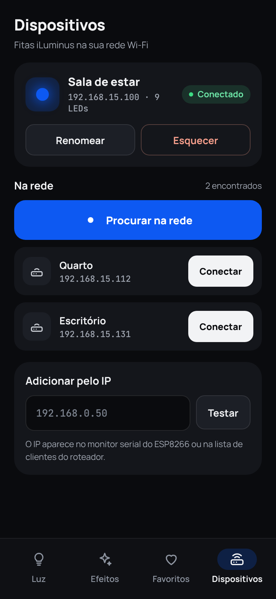
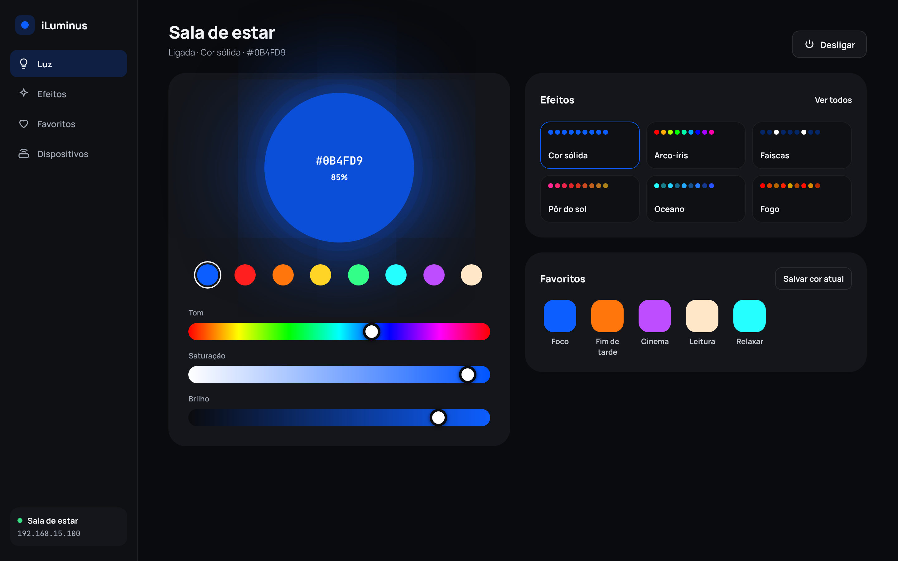

# Design — redesign do iLuminus (out/2026)

Mockups aprovados que guiaram o redesign do app. O app implementado segue estas telas,
com pequenas diferenças descritas no fim.

| Android · Luz | Android · Efeitos | Android · Favoritos | Android · Dispositivos |
|---|---|---|---|
|  |  |  |  |

**Web · desktop**

## Princípios

- **A cor da fita é a protagonista.** A luz grande na tela Luz brilha na cor e no brilho
  atuais e liga/desliga a fita com um toque. É o único elemento colorido da interface;
  o resto é neutro.
- **Sliders em vez de roda de cor.** Tom, saturação e brilho funcionam bem com o dedo e com
  o mouse, e cabem em qualquer largura. Sete cores prontas cobrem o uso rápido.
- **Prévia dos 9 LEDs.** Cada efeito mostra como fica na fita (o firmware usa 9 LEDs), em vez
  de emoji ou ícone genérico.
- **Navegação:** abas embaixo no Android (Luz, Efeitos, Favoritos, Dispositivos), alcançáveis
  com o polegar; sidebar fixa no desktop.
- **Acessível:** alvos de toque de 44 px ou mais, contraste de texto de 4,5:1 ou mais,
  controles reais (`button`, `input`, `label`).

## Tokens

| Token | Valor | Uso |
|---|---|---|
| Fundo | `#0A0B0E` | tela |
| Fundo elevado | `#0F1014` | barra de abas, sidebar |
| Superfície | `#14161B` | cartões |
| Superfície 2 | `#1C1F26` | botões secundários, trilhos |
| Texto | `#F2F3F5` | títulos e texto principal |
| Texto secundário | `#A3A9B4` | legendas |
| Texto apagado | `#8E95A1` | abas inativas, dicas |
| Sucesso | `#3DDC84` | conectado |
| Alerta | `#F59E8B` | ações destrutivas, erros |
| Cor da fita | dinâmica | luz, destaques de seleção (`--app-led`) |

Tipografia: **Manrope** (interface) e **JetBrains Mono** (IP e códigos de cor). Raios: 22 px
nos cartões, 12–14 px em botões e campos.

No código, os tokens ficam em [`src/styles.scss`](../../src/styles.scss).

## Arquivos

| Pasta | Conteúdo |
|---|---|
| `telas/` | PNG de cada tela (2x) |
| `html/` | HTML estático de cada tela, para abrir no navegador (usa Google Fonts) |
| `fonte/` | Arquivos originais do canvas de design (`.dc.html` + `canvas.json`). Precisam do runtime do canvas para rodar; servem como referência. |

## Diferenças no app implementado

- O nome da fita é "Minha fita" por padrão e pode ser renomeado em Dispositivos
  ("Sala de estar" no mockup é um exemplo).
- Na tela Luz, os favoritos aparecem também no celular, abaixo dos efeitos rápidos.
- Dispositivos ganhou o botão "Testar" para checar a conexão.
- O cabeçalho flutua sobre o conteúdo, para o brilho da luz passar por trás do título.
- Nomes, IPs e horários nos mockups são exemplos.
